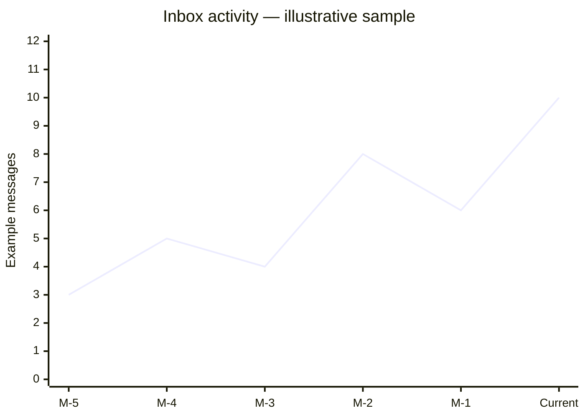

<div align="center">
  
  <h1>CupidCreativeX Ventures</h1>
  <p><strong>A content-managed creative agency website with a live Supabase-powered admin studio.</strong></p>

  <p>
    <a href="https://github.com/cupidnavaz/CupidCreativeX-Ventures-"></a>
    <a href="https://github.com/cupidnavaz/CupidCreativeX-Ventures-/forks"></a>
    <a href="https://github.com/cupidnavaz/CupidCreativeX-Ventures-/issues"></a>
    
  </p>
  <p>
    
    
    
    
    
  </p>
</div>

<p align="center">
  <a href="#overview">Overview</a> ·
  <a href="#features">Features</a> ·
  <a href="#dashboard-analytics">Dashboard analytics</a> ·
  <a href="#quick-start">Quick start</a> ·
  <a href="#project-structure">Project structure</a>
</p>

> **At a glance** — A responsive public-facing agency site, a 13-section admin workspace, and a Supabase content layer. Repository badges above refresh from GitHub; project counts below describe the current source, not live business results.

<table>
  <tr>
    <td align="center"><strong>08</strong><br>public route patterns</td>
    <td align="center"><strong>13</strong><br>admin workspaces</td>
    <td align="center"><strong>12</strong><br>Supabase content tables</td>
    <td align="center"><strong>07</strong><br>database migrations</td>
  </tr>
</table>

## Overview

CupidCreativeX Ventures pairs a polished agency website with an admin area for managing the content behind it. The public experience presents services, projects, team members, testimonials, articles, and contact options. Authenticated users can update that content and monitor incoming messages from one dashboard.

### Brand artwork

The README uses the project's included logo assets; the public site can also use its own configured logo and brand theme.

<table>
  <tr>
    <td align="center" width="68%">
      
      <br><sub>Horizontal wordmark</sub>
    </td>
    <td align="center" width="32%">
      
      <br><sub>Brand mark</sub>
    </td>
  </tr>
</table>

## Features

### Public website

| Page | Route | What visitors can do |
|---|---|---|
| Home | `/` | Explore the agency, featured content, and primary calls to action. |
| Services | `/services` | Browse service offerings and their details. |
| Portfolio | `/portfolio` | Explore project work and project overviews. |
| About | `/about` | Learn about the agency, its story, and mission. |
| Team | `/team` | Meet team members and view their profiles. |
| Blog | `/blog` | Browse published articles. |
| Blog article | `/blog/:slug` | Read an individual article. |
| Contact | `/contact` | Send an inquiry through the contact form. |

### Admin workspace

The `/admin` area is protected by Supabase authentication. Its 13 navigation sections cover:

| Workspace | Route | Capabilities |
|---|---|---|
| Dashboard | `/admin` | Review content KPIs, inbox activity, content mix, and recent messages. |
| Services | `/admin/services` | Manage service descriptions, features, icons, images, and publish state. |
| Projects | `/admin/projects` | Manage portfolio entries, client and category details, imagery, links, and tools used. |
| Team | `/admin/team` | Maintain team profiles, biographies, photos, and social links. |
| Testimonials | `/admin/testimonials` | Manage client quotes, company names, ratings, and avatars. |
| Blog posts | `/admin/blog` | Create and edit articles, excerpts, authors, cover images, and publishing state. |
| Messages | `/admin/messages` | Review contact form submissions and read status. |
| Media gallery | `/admin/media` | Upload and organize media stored in Supabase Storage. |
| Pages | `/admin/pages` | Edit page-specific hero content, section images, and body content. |
| Integrations | `/admin/integrations` | Configure provider, endpoint, webhook, and integration settings. |
| Plugins | `/admin/plugins` | Manage plugin descriptions, versions, configuration, and enabled state. |
| Social links | `/admin/social` | Maintain the public site's social profiles and display order. |
| Settings | `/admin/settings` | Configure brand details, contact information, logo, colors, fonts, and site statistics. |

### Content and platform

- **Supabase-backed content:** public pages are connected to the content schema for services, projects, team members, testimonials, blog posts, page content, settings, and social links.
- **Contact workflow:** the public contact form creates messages that can be reviewed and marked as read in the admin area.
- **Brand theming:** site settings drive the public and admin theme, including the primary/accent/background colors, logo, and heading/body fonts.
- **Media storage:** media records and a Supabase Storage bucket support uploaded site imagery.
- **Responsive navigation:** the public layout and admin sidebar adapt for smaller screens.
- **Database policies:** migrations define row-level security and access policies. Review the policies against your own roles and deployment requirements before production use.

## Dashboard analytics

The dashboard loads its numbers from Supabase; it does not rely on hard-coded business metrics. Four KPI cards show **portfolio projects**, **services**, **team members**, and **unread messages**. The dashboard also includes a six-month inbox trend, a content-library mix, recent messages, loading states, and a manual refresh action.

The chart below is **illustrative sample data** for the README, not a snapshot of this project's database. The running dashboard calculates its chart from real contact-message timestamps.



### Dashboard card inventory

<table>
  <tr>
    <th>📁 Portfolio projects</th>
    <th>🧩 Services</th>
    <th>👥 Team members</th>
    <th>📬 Unread messages</th>
  </tr>
  <tr>
    <td>Live project count with a shortcut to the project manager.</td>
    <td>Live service count with a shortcut to service editing.</td>
    <td>Live team count with a shortcut to team profiles.</td>
    <td>Unread count alongside total inquiries and an inbox shortcut.</td>
  </tr>
</table>

<details>
  <summary><strong>Explore the system architecture</strong></summary>

  ```mermaid
  flowchart LR
      Visitor[Site visitor] --> Public[React public website]
      Admin[Authenticated admin] --> Studio[React admin workspace]
      Public --> Client[Supabase client]
      Studio --> Client
      Client --> Auth[Supabase Auth]
      Client --> DB[(Supabase Postgres)]
      Client --> Storage[Supabase Storage]
      DB --> Content[Content, settings, messages]
      Storage --> Media[Media assets]
  ```
</details>

<details>
  <summary><strong>Browse the data model</strong></summary>

  | Group | Tables |
  |---|---|
  | Agency content | `services`, `projects`, `team_members`, `testimonials`, `blog_posts` |
  | Site experience | `site_settings`, `page_contents`, `social_links` |
  | Operations | `contact_messages`, `media_files`, `integrations`, `plugins` |

  Schema changes live in `supabase/migrations/` and should be applied in timestamp order.
</details>

## Technology

| Layer | Tools |
|---|---|
| UI | React 18, TypeScript, Tailwind CSS |
| Build and development | Vite 5 |
| Icons | Lucide React |
| Data, authentication, and media | Supabase |
| Database | PostgreSQL with SQL migrations and row-level security |

## Quick start

### 1. Requirements

- Node.js and npm
- A Supabase project for database, authentication, and media features

### 2. Install dependencies

```bash
npm install
```

### 3. Configure Supabase

Create a `.env.local` file in the project root:

```env
VITE_SUPABASE_URL=https://YOUR_PROJECT_ID.supabase.co
VITE_SUPABASE_ANON_KEY=YOUR_SUPABASE_PUBLISHABLE_OR_ANON_KEY
```

Apply the SQL files in `supabase/migrations/` to your Supabase project in timestamp order. The app expects the schema and policies from these migrations. Use a publishable/anon key in the browser app; never put a Supabase service-role key in a `VITE_*` variable.

Create or enable an account with Supabase Auth for the admin area. The sign-in page is available at `/admin/login`.

### 4. Start the development server

```bash
npm run dev
```

Vite prints the local URL when the server is ready.

### 5. Production build and checks

```bash
npm run build
npm run preview
npm run lint
npm run typecheck
```

## Project structure

```text
src/
├── components/
│   ├── admin/       # Admin shell and navigation
│   └── public/      # Shared public-site layout and components
├── lib/             # Supabase client, auth, routing, theme, content helpers
└── pages/
    ├── admin/       # Dashboard and content-management workspaces
    └── public/      # Visitor-facing pages
public/              # Static brand assets
supabase/
└── migrations/      # Ordered database and policy changes
```

## Useful commands

| Command | Purpose |
|---|---|
| `npm run dev` | Start the local Vite development server. |
| `npm run build` | Create an optimized production build in `dist/`. |
| `npm run preview` | Preview the production build locally. |
| `npm run lint` | Run ESLint. |
| `npm run typecheck` | Type-check the application TypeScript project. |

## Notes

- `.env` and `.env.local` are intentionally ignored by Git. Keep credentials out of commits, screenshots, and issue reports.
- The repository badges above update from GitHub metadata. The route, workspace, table, and migration totals are a source snapshot and should be updated if the project structure changes.
- No production URL, license, or sample client/project results are claimed here.

<p align="center">
  <sub>Built with care by CupidCreativeX Ventures.</sub>
</p>
